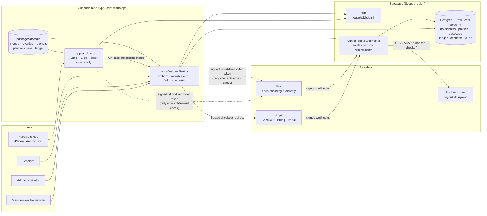

# Architecture & deployment (one page)

## How money and minutes flow
1. A parent buys on the **website** → Stripe Checkout → Stripe sends a **signed webhook** → we fetch the
   subscription from Stripe and switch the household on. (We never trust the browser's "success" page.)
2. A profile presses play → our server checks **entitlement + age band + PIN** → mints a **signed Mux token**
   valid for minutes, not days.
3. The player sends a **heartbeat** every ~12 s → the server rebuilds which parts were genuinely played →
   aggregated **qualified minutes** (raw heartbeats deleted after 90 days).
4. Month end: Stripe invoice snapshots → **net receipts** (minus GST, fees, refunds) recognised per service month →
   **royalty pool** (household-balanced) + **referral commission** → **append-only ledger** + frozen snapshot.
5. On the due date → **payout batch** (maker creates, checker approves) → bank file → confirmation imported → paid.

## Key decisions
| Decision | Choice | Why |
|---|---|---|
| Repo | pnpm monorepo, TypeScript everywhere | One set of rules shared by web, mobile and server — the royalty maths can't drift between apps |
| Shared logic | `packages/domain` (pure functions, no I/O) | Fully unit-testable; same code runs in browser, phone and server |
| Money | Integer cents, BigInt for multiplication, largest-remainder splitting | Cent-exact, reproducible, no rounding residue |
| Web | Next.js 16 (App Router) | Website, member app, admin and creator portal in one deployable |
| Mobile | Expo SDK 58 + Expo Router | One codebase for iOS/Android; cloud builds via EAS (no Mac needed) |
| Data/auth | Supabase Postgres + RLS | Database-enforced privacy: a creator physically cannot query another creator's rows |
| Billing | Stripe (web) behind a `BillingProvider` abstraction | Apple/Google IAP can be added without touching royalties |
| Video | Mux with signed playback | Pay-as-you-go, no servers to run, signed URLs stop link sharing |
| Integrations | Mock adapters until keys exist | The whole product runs locally with zero accounts |

## Environments
`local` (mock adapters) → `test` (Supabase dev project + Stripe test mode + Mux test) → `staging` → `production`.
Secrets live only in `.env.local` on a developer machine and in the hosting provider's encrypted settings.
`pnpm check:env` refuses a live Stripe key outside production.

## Backups & rollback (summary — full runbook in Phase 6)
Supabase daily backups (Pro plan adds point-in-time recovery); database changes only via versioned migrations;
web deploys are immutable and can be rolled back instantly on Vercel; mobile uses staged store releases + EAS
Update for quick fixes.
